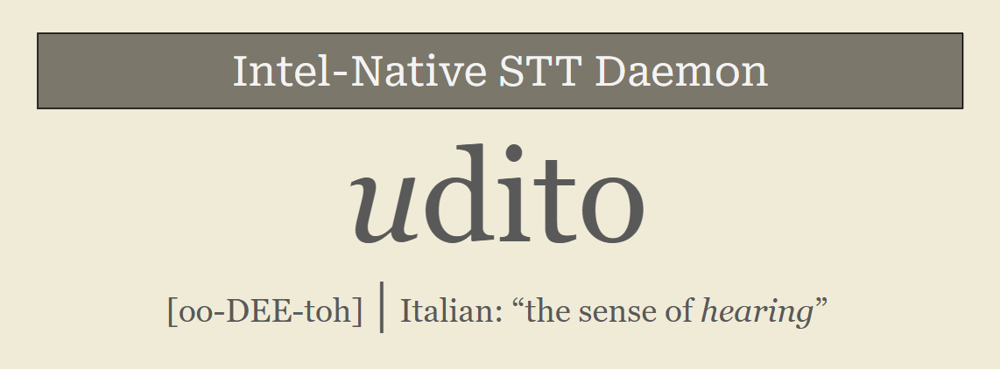

# Udito

**Speech-to-text that never stops listening.**

*oo-DEE-toh*, Italian for **the sense of hearing.**

A resident speech-to-text daemon for Windows NPU, GPU, and CPU. It loads an
OpenVINO Whisper model once, then serves transcription over localhost TCP.

**Full-length transcription at 38x real-time on the NPU.** A 209-second
recording transcribes in 5.5 seconds with complete coverage, while the same
take costs whisper.cpp small 36 seconds and whisper.cpp medium 109 seconds
on this machine's CPU. The resident daemon holds about 1.0 GB of RAM idle
(1.6 GB with the emotion head resident). The model compile is cached after
the first boot; later boots are ready in about 2 seconds.

```
209s audio -> text in 5.5s    (full stack: pauses + emotion, ~38x real-time)
209s audio -> text in 3.7s    (raw, ~57x real-time)
209s audio -> text in 2.2s    (base model, ~96x real-time)
```



## Features

- **Transcription.** Whisper via OpenVINO GenAI, resident daemon, raw TCP with
  line-delimited JSON. Sliding-window chunking handles takes longer than 30
  seconds.
- **Pause marks.** A voice activity detector finds real acoustic silences.
  Any silence longer than `pause_ms` becomes "..." in the transcript. There
  are no other marks. A period says a sentence ended, and that can be wrong.
  "..." only says the speaker paused, so it never lies.
- **Emotion tags (optional).** A wav2vec2 classifier runs on request and the
  transcript ends with a tag like `[calm 0.84]`. The model is configurable.
  Input is normalized before classification.
- **Noise reduction (optional).** Three settings: off, `afftdn` (FFT based,
  good against fan hum and hiss), `rnnoise` (neural, also removes clicks and
  keyboard noise). The reference model ships in the repo.
- **Quiet-audio boost.** Segments measured as quiet are gain-lifted toward a
  target RMS, with a hard clamp so peaks never clip.
- **Device selection.** `device: auto` probes NPU, then GPU, then CPU, and
  reports what it picked. An unsupported combination fails at boot with the
  reason in the message.
- **Compile cache.** First boot compiles the model and writes a blob. Later
  boots load the blob in about 2 seconds. After a driver update the old blob
  fails to load, the daemon deletes it, recompiles once, and re-caches.
- **Production surface.** Configurable port, health command, max-audio guard,
  client retry, logon autostart (per-user, no admin), and boot-time config
  validation that names the file or key it rejected.

## Quick start

```powershell
copy config.example.yaml config.yaml   # then edit: device, model, port
pip install -r requirements.txt
python main.py models                  # downloads whisper + emotion head from Hugging Face
python main.py start                   # boot headless; first boot compiles once
python main.py status                  # device, model, uptime
```

Everything runs through `main.py`:

| command | what it does |
|---|---|
| `python main.py start` | boot headless: no window, no disturbance, log to daemon.log |
| `python main.py window` | boot in this console: live log, Ctrl+C stops it |
| `python main.py stop` | polite shutdown over the wire |
| `python main.py restart` | stop, wait for the port to free, start |
| `python main.py status` | up/down, device, model, uptime |
| `python main.py log` | last 40 lines of daemon.log, then follow it live |
| `python main.py transcribe <in> <out> [lang]` | daemon-first CLI, one-shot fallback |
| `python main.py models [size]` | download all models (whisper + emotion head) from Hugging Face |
| `python main.py autostart on` | start at logon, per-user, no admin |

One-shot CLI with daemon-first fallback:

```powershell
udito.bat <input_audio> <output_txt> [language]
```

Ask the daemon over TCP (default port 8764, line-delimited JSON):

```json
{"cmd": "transcribe", "path": "C:/audio/note.webm", "punct": "pause", "emotion": true}
{"cmd": "health"}
```

## Benchmarks

Test hardware: Intel Core Ultra 5 226V (Lunar Lake: P-cores + on-die NPU +
Arc 130V iGPU), 16 GB RAM, Windows 11. The NPU numbers below need an Intel NPU;
on CPU-only machines expect the whisper.cpp-shaped speeds instead.

Same machine, same hour, fresh run on the shipped build, medians of 3 runs.
RAM measured as whole-process RSS via psutil. The whisper.cpp models are the
official 8-bit exports (`q8_0`/`int_8`).

Udito daemon (NPU, whisper-small int8, full coverage on every take):

| record length | raw | full stack (boost + pause detection "..." + emotion) |
|---|---|---|
| 9.9s | 0.38s (26x) | 0.74s (13x) |
| 30.1s | 0.81s (37x) | 1.97s (15x) |
| 29.5s | 0.82s (36x) | 1.94s (15x) |
| 208.7s | **3.65s (57x)** | 5.47s (38x) |
| RAM idle | ~1.0 GB (whisper only) | ~1.6 GB with emotion model |

RAM states measured on the shipped build: idle 951 MB, emotion-resident
1645 MB, 236 MB after the `unload` command. The retired onnxruntime emotion
path cost 2.4 GB whole-process; the OpenVINO head cut that to 1.6 GB.

Where the RAM goes (measured stage by stage, whisper-small): ~30 MB Python
interpreter, ~36 MB OpenVINO runtime, ~960 MB the whisper pipeline. A
245 MB int8 model grows because the compiled NPU graph is staged in host RAM
(the compiled blob on disk is ~700 MB) plus activation scratch and the
allocator's headroom. Then ~110 MB the emotion head (66 MB IR weights + runtime),
and a few hundred MB of request scratch the allocator keeps warm after a
transcribe. The `unload` command returns all of it; the blob cache rebuilds
in ~2 seconds.

Udito daemon (NPU, whisper-base int8):

| take | raw | full stack |
|---|---|---|
| 9.9s | 0.26s (38x) | 0.57s (17x) |
| 30.1s | 0.43s (69x) | 1.55s (19x) |
| 29.5s | 0.45s (66x) | 1.53s (19x) |
| 208.7s | **2.18s (96x)** | 3.35s (62x) |
| RAM idle | ~560 MB (whisper only) | ~1.3 GB with emotion resident |

Standard baselines (CPU, whisper.cpp b5130, fresh process per run):

| take | medium q8_0 | small q8_0 | base q8_0 |
|---|---|---|---|
| 9.9s | 8.86s (1.1x) | 2.78s (3.6x) | 0.96s (10x) |
| 30.1s | 26.3s (1.1x) | 7.53s (4x) | 2.63s (11x) |
| 29.5s | 16.2s (1.8x) | 4.91s (6x) | 1.82s (16x) |
| 208.7s | 108.7s (1.9x) | 36.2s (5.8x) | 12.3s (17x) |
| RAM peak | 1.5-1.6 GB | ~700 MB | 250-370 MB |

### Udito vs whisper.cpp, head to head

Same audio, same hour, best comparable configuration: Udito's full production
stack (boost + pause marks + emotion tag) against the standard CPU
transcription runner most apps use. whisper.cpp transcribes the whole file
(coverage parity) at its fastest model that matches Udito's default.

| 208.7s take | time | speed | RAM | transcript quality |
|---|---|---|---|---|
| **Udito full stack** (small int8, NPU) | **5.5s** | **38x real-time** | ~1.6 GB resident | calm lake, Brunner's, "lets in cold air" |
| whisper.cpp small q8_0 (CPU) | 36.2s | 5.8x | ~700 MB peak | con lake, Bruner, "cool air" |
| whisper.cpp base q8_0 (CPU) | 12.3s | 17x | ~370 MB peak | con lake, "teeth rich" for "teeth itch" |

The same model class (small) runs **6.6x faster on Udito with every feature
on** than the standard C++ runner with none. Speed is the NPU daemon's;
transcript quality is the model's, and Udito's int8 export wins that too on
the same takes.

Reading the tables honestly:

- Speed leader at full coverage, every length, every feature state.
- whisper.cpp runs the long take at full coverage too (it chunks at 30s and
  keeps going); the difference is speed: its medium model takes 108.7s
  (twenty times slower than Udito's full stack), its small model 36.2s
  (6.6x slower than Udito with every feature on).
- On the 30s takes, CPU whisper.cpp base edges the full stack on wall time
  (2.6s vs 2.0s). The full stack buys pauses and emotion for well under a
  second. Raw Udito beats everything outright.
- Base Udito text is weaker than small ("teeth rich" for "teeth itch");
  that is the smaller model, not the stack. Small-Udito raw text beat all
  three C++ runners on the same audio.

## Model family

Change one line in `config.yaml`. No conversion step; the models download
from Hugging Face as ready OpenVINO IR on first use.

| model (OpenVINO/...) | size | tested |
|---|---|---|
| whisper-base-int8-ov | 120 MB | yes |
| whisper-small-int8-ov | 245 MB | yes (default) |
| whisper-medium-int8-ov | 770 MB | IR staged, not NPU-benched |
| whisper-large-v3-turbo-int8-ov | 1.2 GB | GPU/CPU recommended; untested on NPU |

`python main.py models [base|small|medium|large-v3-turbo]` downloads them.
The compile cache is per model and per driver; see `compile_cache` in the
config.

## Hermes wiring

`docs/INTEGRATION.md` holds the full protocol and a worked config. Short
version:

```yaml
stt:
  provider: udito
  providers:
    udito:
      type: command
      command: C:/path/to/udito/udito.bat {input_path} {output_path} {language}
```

## Design choices

- **Fail at boot, loudly.** A bad config exits with the name of the missing
  file and the fix. Nothing silently falls back to a surprising default.
- **One daemon, one model, one device per machine.** The NPU is a sequential
  device; the config says so and the daemon enforces it.
- **Measure on real recordings, publish medians.** The cold compile is
  amortized by the daemon, so steady-state numbers exclude it.
- **Pauses over grammar.** Punctuation restoration models predict sentence
  boundaries and sometimes predict them wrong. This daemon marks what it can
  hear.

Requirements: Windows, Python 3.10+, and ffmpeg on PATH (audio decode). An
Intel NPU (Core Ultra) is needed for the NPU path. Intel iGPU works through
the GPU device; AMD and NVIDIA cards are not supported by OpenVINO and the
boot check says so.

## Config

`config.example.yaml` has every setting annotated. `docs/INTEGRATION.md`
holds the wire protocol and the request-time overrides.

## Credits

- Whisper by OpenAI (MIT). OpenVINO and OpenVINO GenAI by Intel (Apache-2.0).
- RNNoise reference model from the Xiph.Org / Gregor Richards rnnoise-models
  collection (public domain).
- Emotion head based on wav2vec2 (META research, MIT), ONNX community export.

## License

MIT. See LICENSE.